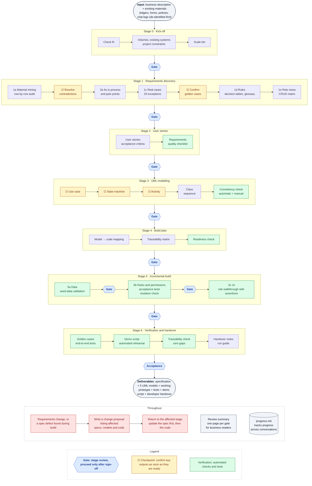

# PM/BA Panda

[中文](README.md) | **English**

**Turn business requirements into a rule-driven, verified prototype of a management system. Built for product managers and business analysts who don't write code.**

You provide a business description and whatever material you already have (Excel ledgers, paper forms, policy documents, chat logs). Claude works like a business analyst: it digs the rules and exceptions out of that material, describes the business in standard UML, builds a prototype from those models that runs locally, and then verifies it against the real cases you told it about.

> Every deliverable has a complete worked example: [`examples/equipment-loan/`](examples/equipment-loan/), a fictional college equipment-loan system that goes all the way from a 9-row Excel ledger to a prototype ready to demo to leadership.
>
> **Language note:** the skill works in the language of the person using it. The worked example (specs, diagrams' explainer cards, screenshots) and `SKILL.md` are written in Chinese; code, database fields and UML element names are in English.

<p>
  
  
</p>

<sub>Left: the example's state machine diagram. Right: the equipment manager's review page in the prototype built from it.</sub>

## Contents

1. [What you get](#what-you-get)
2. [How this differs from "just ask an AI to build a system"](#how-this-differs-from-just-ask-an-ai-to-build-a-system)
3. [What it is for, and what it is not for](#what-it-is-for-and-what-it-is-not-for)
4. [Getting started](#getting-started)
5. [The 7 stages in detail](#the-7-stages-in-detail)
6. [Mechanisms that run throughout](#mechanisms-that-run-throughout)
7. [A walk through the worked example](#a-walk-through-the-worked-example)
8. [Verification: how the prototype is shown to be right](#verification-how-the-prototype-is-shown-to-be-right)
9. [Project file layout](#project-file-layout)
10. [Scripts](#scripts)
11. [Tech stack](#tech-stack)
12. [Privacy and security](#privacy-and-security)
13. [FAQ](#faq)
14. [Known limitations and roadmap](#known-limitations-and-roadmap)
15. [Layout of the skill itself](#layout-of-the-skill-itself)

---

The overall process is shown in the flowchart at the start of [The 7 stages in detail](#the-7-stages-in-detail).

## What you get

| Deliverable | Contents | Who uses it |
|---|---|---|
| Specification | Business rules (each with its source), decision tables, glossary, role view table, CRUD permission matrix, user stories and acceptance criteria, real cases | You, business stakeholders, developers |
| 5 UML models | Use case, activity, sequence, state machine and class diagrams, plus an as-is process diagram. Each diagram comes with a plain-language explainer card | You, business stakeholders, developers |
| Working prototype | Pages for each role, states that change according to the rules, server-side permissions, a tamper-proof audit trail, realistic demo data | Demos to leadership and the business |
| Verification results | Tests for every acceptance criterion, every decision-table row and every real case; a traceability matrix from requirements to code and tests; a mutation-check report | You, developers |
| Handover documents | A 10-minute demo script (already rehearsed automatically), developer handover notes, a run guide | Whoever runs the demo, the team that takes over development |
| Review summaries | One page per stage, in business language with no code | Can be forwarded straight to leadership |

## How this differs from "just ask an AI to build a system"

**1. It mines requirements from real material, not just from what you say.**
What you say is usually how things *should* work; your material records what *actually* happened. The skill audits ledgers and records row by row and looks for three kinds of problem: practices that exist but are written down nowhere (hidden rules), places where practice and policy disagree, and things that should have been done but never were. Every contradiction goes to you for a ruling; neither the written policy nor current practice is assumed to be right. In the example, a row-by-row audit of a 9-row ledger found 3 contradictions, plus a loan 26 days overdue that was still recorded as "on loan".

**2. Every rule has a source.**
Every rule, exception and field is tagged with where it came from: your own words, which document, which real case, or an inference. Anything inferred is confirmed with you. By the prototype stage, every action on the state machine must also name its basis, and a check script flags any that don't.

**3. UML is not documentation you throw away.**
Every diagram is mapped to code by fixed rules: the state machine becomes the only place in the code that can change a status, decision tables become table lookups with one test per row, the CRUD matrix becomes server-side permissions, and the class diagram becomes the database schema. Tests read the diagrams, so when diagram and code disagree, the tests fail.

**4. It stops for you at every stage.**
Each of the 7 stages ends with a stage review (a gate). Within a stage, key outputs are confirmed as soon as they are ready (checkpoints), so a deviation is caught before it spreads to later outputs, instead of discovering at the end that the direction was wrong. Each review asks only 3–5 key questions, in business language; you never have to read code.

**5. It proves the tests are worth something.**
"All tests pass" proves nothing on its own. The skill deliberately plants typical bugs in the code (an off-by-one boundary, a missing notification, an extra permission, a checkbox in the UI that never reaches the server) and confirms the tests catch them. The demo script is also rehearsed automatically, word for word. In the example, all 21 planted bugs were caught; the first rehearsal found that a piece of equipment chosen in the script was held by an overdue loan, which would have made the live demo fail at the approval step.

**6. Spec problems found during the build are not worked around.**
When coding exposes a gap or contradiction in the spec (for example, the same notification drawn twice on a diagram), Claude stops and tells you. Anything that affects the rules goes through the change process: update the spec first, then the code.

## What it is for, and what it is not for

- **Good fit:** process-oriented management systems, meaning internal systems with several roles, approval or review steps, and records that move through states. For example equipment loans, leave approval, purchase approval, clinic appointments, ticket handling, case management, equipment repair.
- **Not a fit:** games, content communities, apps centred on AI generation, real-time multi-user collaboration, native mobile apps. Requests like these are turned down in the first stage, with the reason.
- **Specification and models only, no prototype:** stop after stage 4 and deliver the specification, models, traceability matrix and review summaries.
- **Your company mandates a tech stack or a low-code platform:** the specification and models are produced as usual; the build follows your stack, or produces a configuration checklist for the low-code platform instead (see [Tech stack](#tech-stack)).

## Getting started

### 1. Add the skill to Claude

Add the `pmba-panda` folder as a skill in the Claude environment you use.

### 2. Describe what you need

Say what you want to build, ideally with how it is done today. For example:

> Our equipment room manages loans with an Excel ledger and paper request forms. Approvals mean walking forms between offices for signatures, and overdue items are found far too late. I want a prototype to demo to leadership. I can send you the ledger and the loan policy.

A vague idea is fine too: Claude asks one question at a time to fill in the gaps.

### 3. Prepare material (strongly recommended)

Share whatever you can get: the Excel ledger in use, photos of paper forms, policies, approval emails, chat screenshots, screenshots of existing systems. The more real the material, the more accurate the rules. **De-identify it first:** replace names, student or staff numbers, phone numbers and ID numbers with codes. If Claude spots what looks like real personal information while reading, it stops and points it out.

### 4. Follow the gates

At the end of each stage, Claude shows you the outputs and a one-page review summary and asks a few key questions. Answer, or say "OK", to move to the next stage; if you have comments, they are fixed on the spot.

### Requirements

| For | You need |
|---|---|
| Running the check scripts | Python 3 |
| Rendering UML diagrams locally | Java; PlantUML is downloaded automatically on first run. Graphviz is optional; without it PlantUML's built-in layout is used |
| Running the prototype | Node.js 20 or later |
| Running end-to-end tests | Run `npx playwright install chromium` once beforehand |

## The 7 stages in detail



<sub>Flowchart source: [`docs/skill-flow.en.mmd`](docs/skill-flow.en.mmd). If it does not render above, see [`docs/skill-flow.en.png`](docs/skill-flow.en.png).</sub>

### Stage 0: Kick-off

- **What Claude does:** checks whether the request is a fit; restates your requirement for you to correct; asks about volumes (how many cases a day, when the peaks are, desktop or phone), existing systems to integrate with, and project constraints (personal data, how long records are kept, industry regulation); proposes a scale tier.
- **What you provide:** the business description, existing material, constraints.
- **Outputs:** project brief, constraints list, materials folder.
- **Gate:** Are the problem and the success criteria right? Are any roles or processes missing? Are the constraints right? Do you agree with the scope and the scale tier?

### Stage 1: Requirements discovery

Five steps; every finding is tagged with its source:

| Step | What happens |
|---|---|
| 1a Material mining | Extract entities, rules and roles from ledger columns and status values, form fields and policy clauses; **audit every record row by row** (durations, amounts, approvals, whether status and dates agree); when historical data must be migrated, also decide for each row whether it can be imported into the new system |
| 1b As-is and pain points | Draw today's process as an as-is diagram and mark duplicate data entry, waiting, and steps that rely on memory |
| 1c Real cases | Ask you about recent concrete cases; go through the exception checklist (33 items in 9 groups: withdrawal, multi-level approval, timeouts, overdue items, insufficient resources, external system down, special approvals …); turn them into **golden cases**, which later become acceptance tests |
| 1d Target process and rules | Business rules BR-xx, multi-condition rules as **decision tables** (checking every combination of conditions has an outcome), glossary |
| 1e Two views to catch gaps | **Role view table** (what each role sees after login, can do, cannot do) and **CRUD matrix** (whether each role can create, read, update or delete each kind of data) |

- **Checkpoints within the stage:** contradictions in the material are resolved with you one by one; each golden case is read back to you for confirmation.
- **Gate:** each rule and each decision-table row is restated as a sentence for you to confirm; are the handling of exceptions, the role views and the as-is pain points right?

### Stage 2: User stories

- **What Claude does:** writes the rules as user stories (functional and non-functional) with observable, verifiable acceptance criteria, each citing the rule it is based on; runs the requirements quality checklist (complete, unambiguous, testable, consistent).
- **Gate:** the quality checklist passes with no open questions; do the stories say what you want?

### Stage 3: UML modelling

| Model | What it decides in the prototype | When you see it |
|---|---|---|
| Use case | Roles, permissions, feature list | As soon as it is drawn (checkpoint) |
| State machine | States and the allowed changes between them | As soon as it is drawn, walking one golden case through it |
| Activity | Process steps, branches and conditions | As soon as each one is drawn |
| Class | Database structure | At the gate |
| Sequence | Call order inside the system | At the gate |

Each diagram comes with an explainer card: what it says, how to read it, your case walked through it, which part of the prototype it decides, and what to check. A consistency check follows: a script covers the automatic part (consistent naming, reachable states, no duplicated effects, every action has a source, and so on), and Claude works through the manual part item by item (8 groups of checks in all).

- **Gate:** no unresolved blocking issues in the consistency check; do the diagrams match the business as you understand it?

### Stage 4: Build plan

- **What Claude does:** turns each diagram into an implementation list using the mapping rules; generates the traceability matrix (story → rule → model element → code → test); sets the build order; runs a readiness check (build plan checked line by line against the diagrams, numbers in the plan consistent with the specification, no open questions).
- **Gate:** do you agree with the build order, the demo data and accounts, what will be simulated, and what is left for production development?

### Stage 5: Incremental build

| Sub-stage | What is built | How it is verified | What you see |
|---|---|---|---|
| 5a Data | Database from the class diagram; realistic demo data (records imported from your material, plus generated history) | Seed-data validation tests: date order, approval order, fees, no double-booked equipment, record-by-record match with the material | A check page with data in every state |
| 5b Rules and permissions | State transitions, guards, decision tables, permissions, audit trail, simulated interfaces to external systems | One test per acceptance criterion; mutation check | Test results in business language, plus the points that need your decision |
| 5c UI | Home page and process pages for each role | Role walkthrough with assertions (including "make a mistake → fix it → resubmit"), accessibility scan, phone width | Screenshots of each role's pages |

### Stage 6: Verification and handover

- **What Claude does:** writes each golden case as an end-to-end test driven through the UI; writes the demo script and rehearses it automatically; writes developer handover notes and a run guide; runs a final traceability check against real test-run reports.
- **Gate:** do the results match what you described? Are the demonstration-only requirements acceptable? Is anything missing from the handover notes? Do you accept the prototype?

## Mechanisms that run throughout

### Source tags

The tags are written in Chinese in the specification files; their meanings:

| Tag | Meaning |
|---|---|
| `[用户]` (user) | Your own words |
| `[材料: 文件名]` (material: file) | Extracted from material you provided |
| `[案例: 编号]` (case: id) | From a real case |
| `[模式库]` (pattern library) | A common practice for this kind of business; must also be marked as to-be-confirmed |
| `[推断]` (inference) | Claude's inference; must also be marked as to-be-confirmed |
| `[待确认: 具体问题]` (to be confirmed: question) | Not yet confirmed. Stages 2 and 4 cannot pass while any remain |

### Gates, checkpoints and quiet mode

- **Gate:** at the end of each stage Claude stops; the next stage starts only after you explicitly agree. Stages are never run back to back.
- **Checkpoint:** key outputs (the contradiction log, golden cases, use case, state machine and activity diagrams) are confirmed as soon as they are ready, one question at a time. Errors propagate into later outputs, so the earlier they are caught, the less rework.
- **Quiet mode:** if you say something like "don't interrupt me" or "show me when it's done", checkpoints are skipped; gates, contradiction rulings and open questions still need your answer.

### Numbering and traceability

Business rule BR-xx → acceptance criterion FUSn-ACm → model element (e.g. state transition T3) → code → test: every link carries an ID. Any rule can be traced to the diagram, code and test where it lives; any piece of code can be traced to why it exists.

### The glossary is the single source of names

Entity, state and role names in diagrams, code and database all come from the glossary, which gives each term in Chinese and English. One diagram calling someone an "applicant" while another calls them a "borrower" cannot happen.

### Changing requirements

When a confirmed specification changes, the code is not edited directly. A change proposal comes first: why, what changes, and, from the traceability matrix, which rules, stories, diagrams and code are affected. After you confirm, the changes are made, merged back into the specification and archived. Wording or layout changes are made directly in the UI and recorded.

### Continuing across conversations

A project usually spans several conversations. After every gate and checkpoint, the progress log `spec/progress.md` is updated. At the start of a new conversation Claude reads it and tells you in a sentence or two where things stand and what comes next, without asking everything again.

### Scale tiers

All five UML models are produced at every tier; the tier only sets how many and how detailed:

| Tier | For | Activity / sequence | State machine | Class |
|---|---|---|---|---|
| Lite | 1 core process, up to 3 roles | 1 each | 1 | Core entities only |
| Standard | 2–3 core processes | 1 per process | 1 | Complete |
| Full | 4+ core processes, or many constraints | 1 per process | 1 per entity with a lifecycle | Complete |

## A walk through the worked example

`examples/equipment-loan/` is a fictional college equipment-loan system (standard tier: 2 core processes, 4 kinds of role). All organisations, people and data are fictional. The example's documents are in Chinese.

**Starting point:** the equipment room manages loans with an Excel ledger and paper request forms. The product owner wants a prototype to demo to college leadership and get the project approved. The material is a 9-row ledger, a request form and a loan policy.

**What stage 1 found in the material:**

- The request form says "no more than 30 days"; the policy says "normally 14 days, 7 for valuable equipment, longer for teaching". The user's ruling was turned into a 6-row decision table.
- The policy only says "10 yuan per day overdue", yet the ledger has a fine that was waived because "the director said let it go this time". Ruling: always charge from now on, no special waivers, with a 200-yuan cap.
- The policy only bars people with *unreturned overdue* items, yet the ledger shows a student refused for *having been overdue before*, even though everything had been returned and paid. Ruling: follow the policy. This later became a golden case that checks the system does not apply a blanket ban.
- A microphone loan 26 days overdue was still recorded as "on loan"; the manager only went through the ledger on Fridays.
- 3 ledger rows had no dates and could not be imported into the new system. The user decided to keep them in the old ledger for reference only.

**Stages 2–4:** 13 business rules, 2 decision tables, 5 golden cases, 61 acceptance criteria, 8 UML diagrams; the manual consistency check found and fixed 3 blocking issues.

<p>
  
  
</p>

**Spec problems found and handled during the stage 5 build:**

- The class diagram had nowhere to store a cancellation reason or notifications: change proposal 001.
- Two notifications were drawn twice on the state machine (once on the transition, once on entering the state), which would have sent duplicates; the permission matrix contradicted an acceptance criterion: change proposal 002.
- 5 places where the spec was unclear (for example, exactly when the "due soon" reminder is sent) were implemented in the simplest reading and confirmed with the user one by one at the gate.
- The role walkthrough found 3 UI problems that unit tests cannot catch, such as "fix one field, resubmit, and everything else you typed is gone". All fixed.

<p>
  
  
</p>

<sub>Left: the request form on a phone; submitted empty, every field says what is missing. Right: returning an overdue item at the counter; 26 days overdue is charged the 200-yuan cap, and the return cannot be recorded until "fee collected" is ticked.</sub>

**Stage 6:** all 5 golden cases run end to end through the UI; the demo script, organised around the 7 as-is pain points, passed its automated rehearsal; the demo script and developer handover notes were delivered and the user accepted the prototype.

| Figure | |
|---|---|
| Unit and integration tests | 150 |
| End-to-end tests driven through the UI | 8 (5 golden cases, the demo-script rehearsal, "fix a mistake and resubmit") |
| Mutation check | 21 planted bugs, all caught |
| Traceability gaps | 0 (every one of the 61 acceptance criteria, every decision-table row, all 11 state transitions and all 5 golden cases have passing tests) |

Start from [`examples/equipment-loan/README.md`](examples/equipment-loan/README.md), or open the 9 review summaries in `spec/reviews/` in order to follow the project from the beginning.

## Verification: how the prototype is shown to be right

| Method | What it proves | When |
|---|---|---|
| Consistency check | The 5 diagrams do not contradict each other or the specification | Stage 3, and after every diagram change |
| Seed-data validation | The demo data follows every rule and matches the material record by record | 5a |
| Acceptance tests | Every acceptance criterion, decision-table row and state transition behaves as specified | 5b |
| Mutation check | The tests really catch bugs: plant a bug, the tests must fail | Every stage from 5b |
| Role walkthrough with assertions | Each role can actually use the system: after every action, the page shows a confirmation or an error | 5c |
| Golden-case end-to-end tests | The real scenarios you described run end to end through the UI | Stage 6 |
| Demo-script rehearsal | Every step of the demo script works exactly as written | Stage 6 |
| Traceability check | Every requirement has code and passing tests, and no feature exists without a requirement | Stage 4 (plan) and stage 6 (result) |

A golden case that fails means one of two things: the prototype has a defect, or the specification missed something. Either way, you are told.

How the skill itself was verified and improved (a comparison with direct generation, the 23 problems found in a full project and how each was fixed, and the limitations) is described in [`docs/validation.en.md`](docs/validation.en.md).

## Project file layout

```
<your project>/
  spec/
    00-materials/          Material you provided (de-identified)
    00-brief.md            Brief, scope, scale tier, volumes, existing systems
    00-constraints.md      Project constraints (privacy, retention, regulation …)
    01-mining.md           Findings from the material, row-by-row audit, contradiction log
    01-as-is.md            As-is process and pain points
    01-cases.md            Real cases and exception checklist results
    01-actors.md           Actors
    01-role-views.md       Role view table
    01-processes.md        Target processes
    01-rules.md            Business rules BR-xx
    01-decision-tables.md  Decision tables
    01-crud-matrix.md      Role × data permission matrix
    glossary.md            Glossary
    golden-cases.md        Golden cases
    02-stories.md          User stories and acceptance criteria
    02-quality-check.md    Requirements quality checklist results
    models/                UML sources, images, explainer cards, consistency report
    04-build-plan.md       Build plan
    04-readiness.md        Readiness check
    trace.csv              Traceability matrix
    trace-gaps.md          Traceability gaps
    06-demo-script.md      Demo script
    06-handover.md         Developer handover notes
    reviews/               One-page review summary per gate, plus screenshots
    changes/               Change proposals (moved to archive/ when done)
    progress.md            Progress log
  app/                     Prototype code, demo-data scripts, all tests
```

## Scripts

Run from the skill's root folder; `<project>` is the project folder that contains `spec/`.

| Script | Usage | What it does |
|---|---|---|
| `render_uml.sh` | `scripts/render_uml.sh <project>/spec/models` | Renders every `.puml` to PNG and SVG locally. Downloads PlantUML if it is not found; `--kroki` uses a public rendering service instead (this sends the diagrams over the internet; only with the user's agreement) |
| `check_consistency.py` | `python3 scripts/check_consistency.py <project>` | The automatic part of the consistency check, written to `models/consistency-report.md`. Re-runs replace only the automatic part; manual results are kept |
| `build_trace.py` | `python3 scripts/build_trace.py <project> --plan` | Stage 4: builds the traceability matrix from specification and models only, listing gaps in the plan |
| | `python3 scripts/build_trace.py <project> --test-report unit.json --test-report e2e.json` | Stage 6: reads real test names from test-run reports (Vitest/Jest JSON or JUnit XML); failing tests do not count as coverage |
| `mutation_check.py` | `python3 scripts/mutation_check.py tests/mutations.json --root <project>/app --after "npx next build"` | Mutation check: plants each bug from a list, runs the tests, restores the code, and reports which bugs were caught. `--cmd` sets the test command, `--only` runs one entry, `--out` writes a report |

## Tech stack

The default (used when you do not specify one):

| For | Choice |
|---|---|
| Application | Next.js (App Router) + TypeScript |
| Database | Single-file SQLite with Drizzle ORM |
| Validation | zod, all server-side |
| Sign-in | bcryptjs + jose signed sessions |
| UI | Tailwind CSS, shadcn/ui-style components, lucide icons, system fonts only |
| Tests | Vitest (unit, integration), Playwright (end-to-end), axe-core (accessibility) |

Why this stack: one command runs it locally with no separate database to install, so non-technical users can run and demo it themselves; every page action goes through a server function, so rules and permissions are naturally enforced on the server. The prototype needs no internet access at runtime, so a demo still works when the meeting-room network is down.

- **Your company mandates a stack** (e.g. Java + Spring): the UML-to-code mapping does not depend on the stack; it is written for your stack with the same layering.
- **Building on a low-code platform:** stages 0–4 as usual; stage 5 produces a configuration checklist instead.
- **Specification and models only:** stop after stage 4.

## Privacy and security

- **De-identify material first:** you are reminded to replace names, phone numbers, ID numbers and similar with codes before sharing; anything that looks like real personal information is pointed out.
- **Demo data is always fictional:** whatever your constraints say, demo data uses fictional people and contact details only.
- **Diagrams are rendered locally by default:** diagram content does not leave your machine; a public rendering service is used only with your explicit agreement and only for diagrams with no real business information.
- **External systems are always simulated:** the prototype connects to no real email, SMS, messaging or third-party system; pages are labelled "simulated data" and "simulated notification".
- **Protections built into the prototype:** server-side permission checks, lockout after failed sign-ins, partially hidden phone numbers, and an audit trail that the database itself refuses to modify or delete. These show what the production system should do; the prototype itself should not be exposed to the internet.

## FAQ

**I don't know UML. Will I be able to follow?**
Yes. Every diagram has an explainer card that says in plain language what it shows and how to read it, and walks one of your own cases through it. All you have to judge is "is this how the business works?".

**I have no material, only an idea. Is that enough?**
Yes. Claude asks one question at a time to fill in the requirements. Material makes the rules more accurate, though; even a photo of one form helps.

**How long does a project take?**
It depends on the complexity of the business and how quickly you answer. The worked example (standard tier, 2 core processes, 4 kinds of role) took several conversations. The progress log lets you stop at any point and pick up later.

**Can the prototype go live as it is?**
No. It is for demonstrating and confirming requirements: external systems are simulated, the database is a single file, and the daily overdue check is triggered by a button. The handover notes list every part that production development must replace, with alternatives.

**What if requirements change halfway?**
Just say so. Changes that affect rules start with a change proposal listing the affected specification, diagrams and code, and go ahead after you confirm; wording and layout changes are made directly.

**How can I check Claude's work myself?**
Read each stage's review summary; walk your own cases through the diagrams using the explainer cards; click through the golden cases in the prototype with the demo accounts. All check scripts can also be re-run yourself.

## Known limitations and roadmap

- **No pattern library yet:** common rules and exceptions for approval workflows, ticket handling, appointment scheduling, item lending and case management are to be built up over time, to make stage 1 questions more targeted. For now stage 1 relies on the general exception checklist and question bank.
- **One complete example:** equipment loans (item lending + approval workflow). Other kinds of business have not been run end to end yet.
- **One default tech stack:** the mapping rules apply to any stack, but there is no ready-made project template for others.
- **"Working days" exclude weekends only:** the example has no public-holiday calendar; a production system needs one.

## Layout of the skill itself

```
SKILL.md                         Claude's workflow: 7 stages, gates, principles (in Chinese)
README.md                        Chinese README
README.en.md                     This file
LICENSE                          MIT licence
references/                      Methods and checklists read on demand at each stage
  elicitation-questions.md         Question bank for discovery, and when to stop asking
  artifact-mining.md               Extracting rules from ledgers, forms and policies; row-by-row audit
  exception-checklist.md           33 business exceptions in 9 groups
  decision-table-guide.md          How to write decision tables
  acceptance-criteria-guide.md     How to write acceptance criteria
  nfr-catalogue.md                 Non-functional requirement categories
  requirements-quality-checklist.md  Requirements quality checklist
  plantuml-pitfalls.md             Standard forms and common mistakes for the 5 UML diagrams
  consistency-checklist.md         Cross-diagram consistency checks (8 groups, A–H)
  uml-to-code-mapping.md           How UML and the specification map to code and tests
  default-stack.md                 Default stack, project structure, build and demo conventions
  verification-playbook.md         Verification: seed-data validation, mutation check, walkthroughs, demo rehearsal
  plain-language-cards.md          Templates for explainer cards, review summaries and demo scripts
docs/
  validation.md                    Verification report (Chinese)
  validation.en.md                 Verification report (English)
  skill-flow.mmd / .png            Flowchart, Chinese
  skill-flow.en.mmd / .png         Flowchart, English
scripts/
  render_uml.sh                    Render all UML diagrams locally
  check_consistency.py             Automatic part of the consistency check
  build_trace.py                   Traceability matrix and gap list
  mutation_check.py                Mutation check
examples/equipment-loan/         Complete worked example: specs, models, review summaries, change log, prototype and all tests (in Chinese)
```

## Licence

[MIT](LICENSE). Free to use, modify and distribute, including commercially, as long as the licence and copyright notice are kept.
