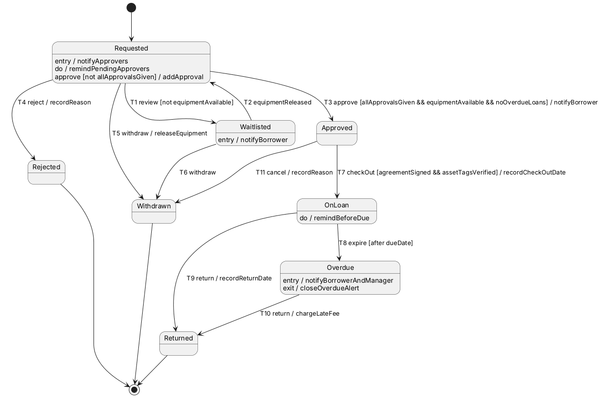
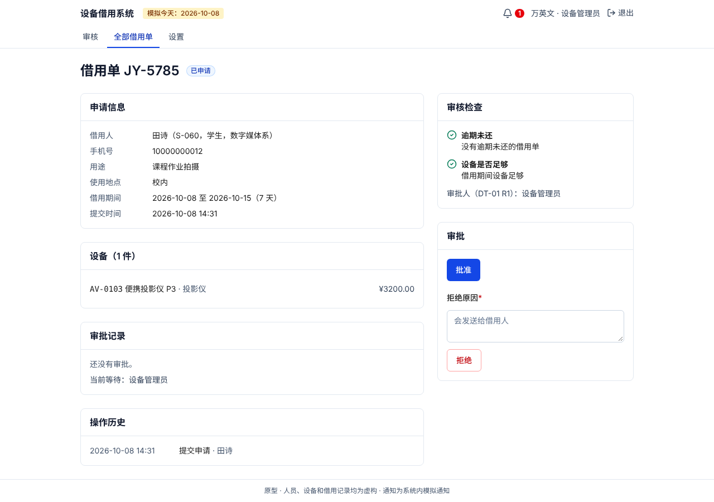
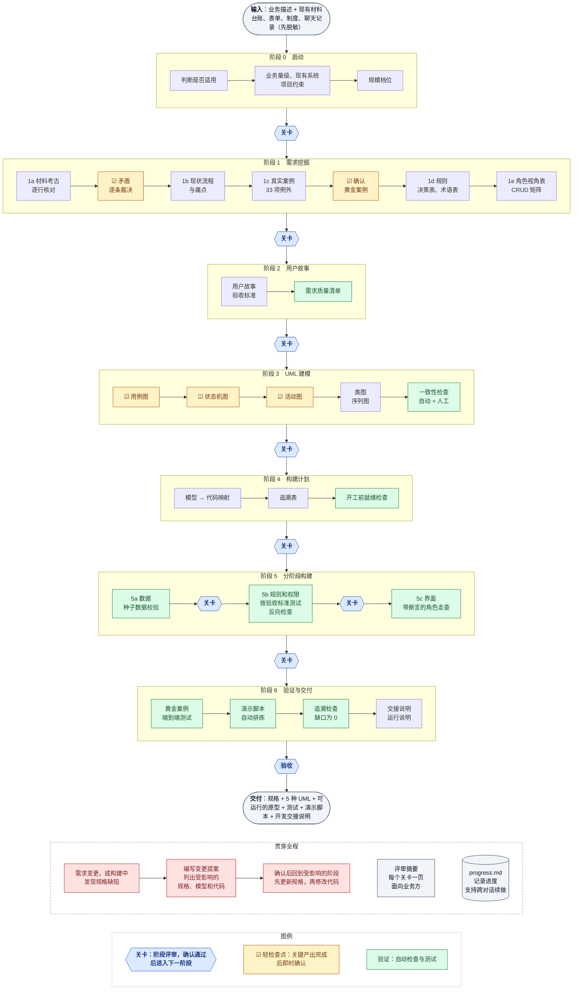
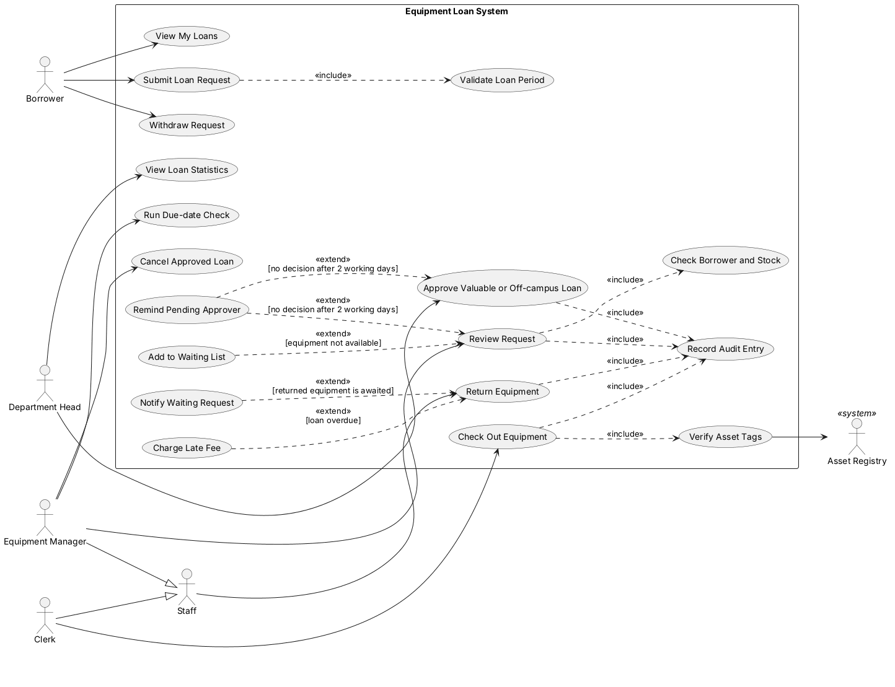
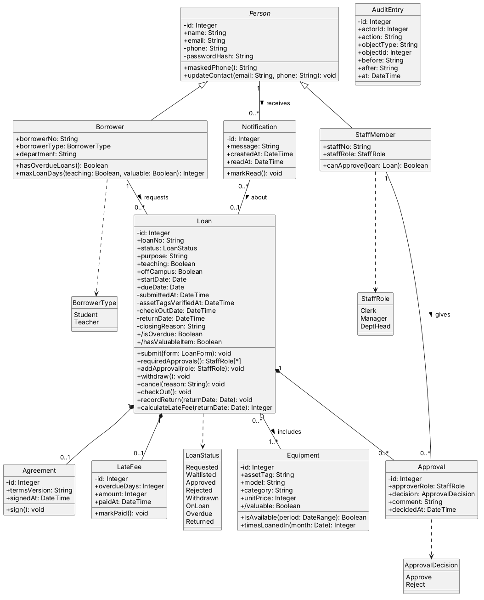
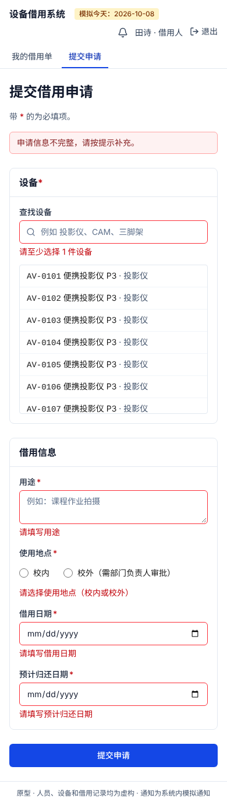
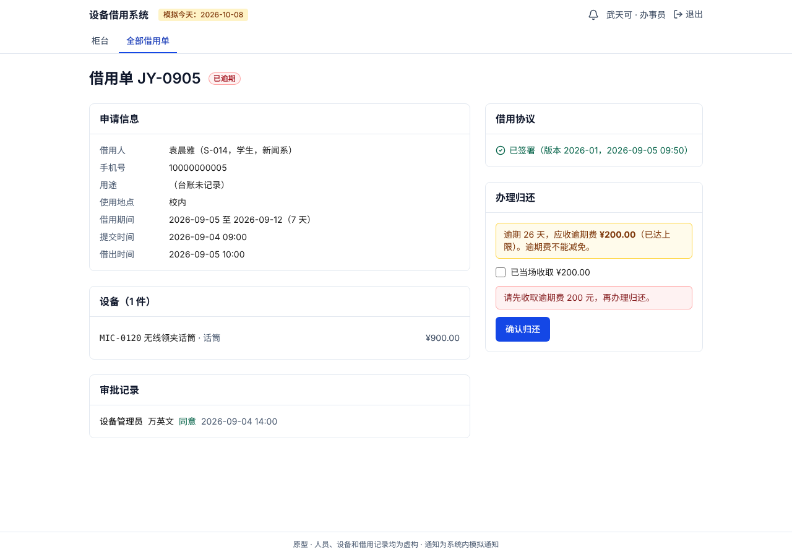

# PM/BA Panda

**中文** | [English](README.en.md)

**把业务需求做成一个按规则运行、经过验证的管理系统原型。给不写代码的产品经理和业务分析师用。**

你提供业务描述和手头的材料（Excel 台账、纸质表单、制度文件、聊天记录），Claude 像业务分析师一样从中挖出规则和例外，用标准 UML 把业务讲清楚，再按这些模型搭出一个能在本地运行的原型，最后用你讲过的真实案例逐一验证。

> 全部产出都有一个完整示例：[`examples/equipment-loan/`](examples/equipment-loan/)，一个虚构的学院设备借用系统，从一份 9 行的 Excel 台账一直做到可以向领导演示的原型。

<p>
  
  
</p>

<sub>左：示例项目的状态机图；右：按这张图搭出来的原型中，设备管理员的审核页。</sub>

## 目录

1. [你会得到什么](#你会得到什么)
2. [和"直接让 AI 写个系统"有什么不同](#和直接让-ai-写个系统有什么不同)
3. [适合什么、不适合什么](#适合什么不适合什么)
4. [开始使用](#开始使用)
5. [7 个阶段详解](#7-个阶段详解)
6. [贯穿全程的机制](#贯穿全程的机制)
7. [用完整示例走一遍](#用完整示例走一遍)
8. [验证：怎么证明原型是对的](#验证怎么证明原型是对的)
9. [一个项目的文件结构](#一个项目的文件结构)
10. [脚本](#脚本)
11. [技术栈](#技术栈)
12. [隐私与安全](#隐私与安全)
13. [常见问题](#常见问题)
14. [已知限制与后续计划](#已知限制与后续计划)
15. [skill 本身的目录](#skill-本身的目录)

---

整体流程见 [7 个阶段详解](#7-个阶段详解) 开头的流程图。

## 你会得到什么

| 产出 | 内容 | 谁会用 |
|---|---|---|
| 规格文档 | 业务规则（每条都标明出处）、决策表、术语表、角色视角表、CRUD 权限矩阵、用户故事和验收标准、真实案例 | 你、业务方、开发团队 |
| 5 种 UML 模型 | 用例图、活动图、序列图、状态机图、类图；另有一张现状流程图。每张图配一张大白话说明卡 | 你、业务方、开发团队 |
| 可运行的原型 | 各角色的页面、按规则流转的状态、服务端权限、不可篡改的操作记录、贴近真实的演示数据 | 演示给领导和业务方 |
| 验证结果 | 每条验收标准、每行决策表、每个真实案例都有测试；从需求追到代码和测试的追溯表；反向检查报告 | 你、开发团队 |
| 交付文档 | 10 分钟演示脚本（已自动排练）、开发交接说明、运行说明 | 演示的人、接手的开发团队 |
| 评审摘要 | 每个阶段一页，用业务语言写，不出现代码 | 可以直接转发给领导 |

## 和"直接让 AI 写个系统"有什么不同

**1. 从真实材料挖需求，不只是整理你说的话。**
你说的往往是"规定应该怎样"，材料里记录的是"实际发生了什么"。这个 skill 会逐行核对台账和单据，找出三类问题：规定没写但实际有一套做法（隐藏规则）、执行口径和规定不一致、该做的事一直没人做。所有矛盾都交给你裁决，不默认规定或实际做法哪一方是对的。示例中，9 行台账核对出 3 处矛盾，还发现一张单逾期 26 天仍记为"已借出"。

**2. 每条规则都有出处。**
每条规则、例外和字段都标明来源：你的原话、哪份材料、哪个真实案例，还是推测。推测出来的一律问你确认。到了原型阶段，状态机图上的每个动作也要写明依据，写不出依据的会被检查脚本找出来。

**3. UML 不是画完就扔的文档。**
每张图都按固定的映射规则落到代码里：状态机变成代码中唯一能改状态的地方，决策表变成查表逻辑和逐行测试，CRUD 矩阵变成服务端权限，类图变成数据库结构。测试会读取设计图，图和代码不一致时测试失败。

**4. 每个阶段都停下来给你看。**
7 个阶段结束时各有一次阶段评审（关卡）；阶段内的关键产出完成后即时确认（轻检查点），在偏差影响后续产出之前发现它，避免全部完成后才发现方向有误。每次只问 3–5 个关键问题，用业务语言，不让你读代码。

**5. 证明测试真的有用。**
"测试全部通过"本身证明不了什么。这个 skill 会故意在代码里埋入典型错误（边界差一、漏发通知、权限多开、界面上的勾选框没传到后台），确认测试能把它们找出来；演示脚本也会按原文自动排练一遍。示例中埋入的 21 个错误全部被发现；第一次排练就发现脚本中选用的一件设备正被一张逾期单占用，如不修正，现场演示会在审批环节失败。

**6. 构建中发现的规格问题不会被绕过。**
写代码时发现规格有漏洞或矛盾（例如设计图上同一个通知画了两次），会停下来告诉你，影响规则的走变更流程，先改规格再改代码。

## 适合什么、不适合什么

- **适合**：流程型管理系统，即有多种角色、审批或检查环节、对象有状态流转的内部系统。例如设备借用、请假审批、采购审批、诊所预约、工单处理、案件管理、设备维修。
- **不适合**：游戏、内容社区、以 AI 生成为核心的应用、实时多人协作、移动端原生 app。遇到这类需求，会在第一个阶段直接说明原因。
- **只要规格和模型、不要原型**：在阶段 4 结束，交付规格、模型、追溯表和评审摘要。
- **公司有指定技术栈或要做在低代码平台上**：规格和模型照常产出，构建部分按你的技术栈写，或改为输出低代码平台的配置清单（见[技术栈](#技术栈)）。

## 开始使用

### 1. 把 skill 加到 Claude

把 `pmba-panda` 文件夹作为一个 skill 加到你使用的 Claude 环境中。

### 2. 描述你的需求

直接说你要做什么，最好带上现在是怎么做的，例如：

> 我们设备室现在用 Excel 台账和纸质申请单管理设备借用，审批要跑办公室签字，逾期也发现得很晚。我想做个原型给领导演示。台账和借用规定我可以发给你。

只有一个模糊的想法也可以，Claude 会一次问一个问题，帮你补齐。

### 3. 准备材料（强烈建议）

能拿到什么就给什么：正在用的 Excel 台账、纸质表单的照片、规章制度、审批邮件、群聊截图、现有系统截图。材料越真实，挖出的规则越准。**发之前先脱敏**：姓名、学号、手机号、证件号换成代号。Claude 读材料时如果发现疑似真实个人信息，会停下来指给你看。

### 4. 跟着关卡走

每个阶段结束时，Claude 会给你看产出和一页评审摘要，问几个关键问题。你回答或说"可以"就进入下一阶段；有意见就当场改。

### 需要的环境

| 用途 | 需要 |
|---|---|
| 运行检查脚本 | Python 3 |
| 在本地渲染 UML 图 | Java；第一次运行时自动下载 PlantUML。Graphviz 可选，没有时用 PlantUML 内置的布局 |
| 运行原型 | Node.js 20 或更高版本 |
| 运行端到端测试 | 第一次运行前执行 `npx playwright install chromium` |

## 7 个阶段详解



<sub>流程图源文件：[`docs/skill-flow.mmd`](docs/skill-flow.mmd)；如果上面没有显示成图，请看 [`docs/skill-flow.png`](docs/skill-flow.png)。</sub>

### 阶段 0：启动

- **Claude 做什么**：判断需求是否适用；复述你的需求请你纠正；问清业务量级（每天多少单、高峰在什么时候、用电脑还是手机）、要对接的现有系统、项目约束（个人信息、记录保留多久、行业法规）；建议一个规模档位。
- **你提供什么**：业务描述、现有材料、约束。
- **产出**：项目简介、约束清单、材料文件夹。
- **关卡**：要解决的问题和判断标准对吗？角色和流程有没有漏？约束对吗？做和不做的范围、规模档位同意吗？

### 阶段 1：需求挖掘

分 5 步，每一步的发现都标出处：

| 步骤 | 做什么 |
|---|---|
| 1a 材料考古 | 从台账的列和状态值、表单的栏位、制度的条款中提取实体、规则、角色；**逐行核对**每条记录（期限、金额、审批、状态与日期是否吻合）；需要导入历史数据时，同时判断每行能否导入新系统 |
| 1b 现状与痛点 | 把现在的做法画成现状流程图，标出重复录入、等待、靠人记的环节 |
| 1c 真实案例 | 请你讲最近的具体案子；按 9 类 33 项例外清单逐项确认（撤回、多级审批、超时、逾期、资源不足、外部系统不可用、特批……）；整理成**黄金案例**，之后会变成验收测试 |
| 1d 目标流程与规则 | 业务规则 BR-xx、多条件规则写成**决策表**（检查所有条件组合都有结果）、术语表 |
| 1e 两个视角查漏 | **角色视角表**（每个角色登录后看到什么、能做什么、不能做什么）和 **CRUD 矩阵**（每个角色对每类数据能否新建、查看、修改、删除） |

- **中途先给你看**：材料中的矛盾逐条请你裁决；黄金案例逐个复述请你确认。
- **关卡**：规则、决策表逐条翻译成句子请你确认；例外的处理方式、角色视角、现状痛点对吗？

### 阶段 2：用户故事

- **Claude 做什么**：把规则写成用户故事（功能和非功能两类）和可以观察、可以验证的验收标准，每条标准注明依据哪条规则；用需求质量清单逐项检查（完整、无歧义、可测试、一致）。
- **关卡**：质量清单通过，没有待确认项；故事说的是你要的吗？

### 阶段 3：UML 建模

| 模型 | 决定原型的哪部分 | 什么时候给你看 |
|---|---|---|
| 用例图 | 角色、权限、功能清单 | 画完立即（轻检查点） |
| 状态机图 | 状态和允许的状态变化 | 画完立即，用一个黄金案例在图上走一遍 |
| 活动图 | 流程步骤、分支和判断条件 | 每张画完立即 |
| 类图 | 数据库结构 | 关卡时 |
| 序列图 | 系统内部的调用顺序 | 关卡时 |

每张图配一张说明卡：这张图讲什么、怎么读、用你的案例走一遍、它决定了原型的哪部分、请你检查什么。画完后做一致性检查：脚本完成自动部分（命名一致、状态可达、效果不重复、动作有出处等），Claude 再逐条完成人工部分（共 8 组检查）。

- **关卡**：一致性检查没有未解决的阻断问题；图符合你理解的业务吗？

### 阶段 4：构建计划

- **Claude 做什么**：按映射规则把每张图转成实现清单；生成追溯表（故事 → 规则 → 模型元素 → 代码 → 测试）；排构建顺序；做开工前就绪检查（构建计划与设计图逐行核对、计划中的数字与规格一致、没有待确认项）。
- **关卡**：构建顺序、演示数据和账号、模拟的部分、留给正式开发的清单，你同意吗？

### 阶段 5：分阶段构建

| 子阶段 | 做什么 | 怎么验证 | 给你看什么 |
|---|---|---|---|
| 5a 数据 | 按类图建库，生成贴近真实的演示数据（导入材料中的记录，生成历史数据） | 数据校验测试：日期先后、审批顺序、费用、设备不重叠、与材料逐条吻合 | 每种状态都有数据的核对页 |
| 5b 规则和权限 | 状态转换、守卫、决策表、权限、操作记录、外部系统的模拟接口 | 每条验收标准一个测试；反向检查 | 业务语言的测试结果，以及实现中需要你决定的事项 |
| 5c 界面 | 各角色的首页和流程页面 | 带断言的角色走查（含"填错 → 改正 → 再提交"）、无障碍扫描、手机宽度 | 各角色页面截图 |

### 阶段 6：验证与交付

- **Claude 做什么**：每个黄金案例写成从界面操作的端到端测试；写演示脚本并自动排练；写开发交接说明和运行说明；用测试运行报告做最后的追溯检查。
- **关卡**：结果和你讲的一致吗？演示类的要求可以接受吗？交接说明要补充什么？是否验收？

## 贯穿全程的机制

### 出处标签

| 标签 | 含义 |
|---|---|
| `[用户]` | 你的原话 |
| `[材料: 文件名]` | 从你提供的材料中提取 |
| `[案例: 编号]` | 来自真实案例 |
| `[模式库]` | 借用这类业务的常见做法，必须同时标待确认 |
| `[推断]` | Claude 的推测，必须同时标待确认 |
| `[待确认: 具体问题]` | 还没确认的内容。有待确认项时，阶段 2 和阶段 4 不能通过 |

### 关卡、轻检查点和少打扰模式

- **关卡**：每个阶段结束时停下，你明确同意后才进入下一阶段，不会连做多个阶段。
- **轻检查点**：关键产出（矛盾清单、黄金案例、用例图、状态机图、活动图）完成后即时确认，每次只问一个问题。前面的错误会传递到后续产出，越早发现，返工越少。
- **少打扰模式**：你说"少打扰我""做完再给我看"，就跳过轻检查点；关卡、矛盾裁决和待确认项仍然必须由你回答。

### 编号与追溯

业务规则 BR-xx → 验收标准 FUSn-ACm → 模型元素（如状态转换 T3）→ 代码 → 测试，每一环都带编号。任何一条规则都能找到它在哪张图、哪段代码、哪个测试里；任何一段代码都能找到它为什么存在。

### 术语表是名字的唯一来源

图、代码、数据库里的实体名、状态名、角色名都出自术语表，并给出中英对照。这样不会出现一张图叫"申请人"、另一张叫"借用人"的情况。

### 需求变更

已确认的规格变化时，不直接改代码，先写一份变更提案：为什么改、改什么、按追溯表列出受影响的规则、故事、图和代码。你确认后再改，改完合并回规格并归档。只改文案或布局的，直接改界面并记录。

### 跨对话续做

一个项目通常跨好几次对话。每个关卡和轻检查点之后都会更新进度日志 `spec/progress.md`。新对话开始时，Claude 先读它，用一两句话告诉你"做到哪里了、接下来做什么"，不会从头再问一遍。

### 规模档位

五种 UML 在任何档位都必出，档位只决定数量和细节：

| 档位 | 适用 | 活动图 / 序列图 | 状态机图 | 类图 |
|---|---|---|---|---|
| 精简 | 1 个核心流程，3 个角色以内 | 各 1 张 | 1 张 | 只含核心实体 |
| 标准 | 2–3 个核心流程 | 每个流程各 1 张 | 1 张 | 完整 |
| 完整 | 4 个以上核心流程，或约束较多 | 每个流程各 1 张 | 每个有状态流转的实体各 1 张 | 完整 |

## 用完整示例走一遍

`examples/equipment-loan/` 是一个虚构的学院设备借用系统（标准档：2 个核心流程，4 类角色）。所有机构、人物和数据都是虚构的。

**起点**：设备室用 Excel 台账和纸质申请单管理借用。产品负责人想做个原型向学院领导演示，争取立项。材料是一份 9 行的台账、一张申请单、一份借用规定。

**阶段 1 从材料里挖出了什么**：

- 申请单写"最长不超过 30 天"，规定写"一般 14 天，贵重设备 7 天，教师教学可延长"。用户裁决后细化为一张 6 行的决策表。
- 规定只写"逾期每天 10 元"，台账里却有一笔"领导说这次算了不收"。用户裁决：以后统一收取，不再特批，另设上限 200 元。
- 规定只禁止"逾期未还"的人借用，台账里却以"有逾期记录"拒绝了一个早已还清并缴费的学生。用户裁决：以规定为准。这条后来成了一个黄金案例，专门验证系统不会一刀切。
- 一张话筒借用单逾期 26 天，台账里仍记为"已借出"。管理员每周五才翻一次台账。
- 有 3 行台账没有日期，新系统无法导入。用户决定只保留在原台账中备查。

**阶段 2–4**：13 条业务规则、2 张决策表、5 个黄金案例、61 条验收标准、8 张 UML 图，一致性检查中人工发现并修正了 3 个阻断问题。

<p>
  
  
</p>

**阶段 5 搭建中发现并处理的规格问题**：

- 类图里没有地方存"取消原因"和"通知"，走了变更提案 001。
- 状态机图上有两处通知画了两次（转换上一次，进入状态时又一次），照图实现会重复通知；权限表和一条验收标准互相矛盾。走了变更提案 002。
- 5 处规格没写清的地方（例如"到期前提醒"到底什么时候提醒），先按最朴素的理解实现，在关卡上逐条请用户确认。
- 角色走查发现"填错一项再提交，其他已填内容被清空"等 3 个界面问题，单元测试发现不了，已修正。

<p>
  
  
</p>

<sub>左：手机上的申请表单，空着提交时每一项都说明缺什么；右：柜台办理逾期归还，逾期 26 天按上限收 200 元，不勾选"已当场收取"不能归还。</sub>

**阶段 6**：5 个黄金案例都从界面跑通；演示脚本按 7 个现状痛点组织，自动排练通过；交付演示脚本和开发交接说明，用户验收。

| 数字 | |
|---|---|
| 单元和集成测试 | 150 项 |
| 从界面操作的端到端测试 | 8 项（5 个黄金案例、演示脚本排练、"填错后改正再提交"） |
| 反向检查 | 埋入 21 个错误，全部被发现 |
| 追溯缺口 | 0（61 条验收标准、每行决策表、11 条状态转换、5 个黄金案例都有通过的测试） |

从 [`examples/equipment-loan/README.md`](examples/equipment-loan/README.md) 开始看，或按顺序打开 `spec/reviews/` 下的 9 份评审摘要，跟着项目从头走一遍。

## 验证：怎么证明原型是对的

| 方法 | 证明什么 | 什么时候 |
|---|---|---|
| 一致性检查 | 5 种图彼此不矛盾，和规格一致 | 阶段 3，之后每次改图 |
| 种子数据校验 | 演示数据符合所有规则，和材料逐条吻合 | 5a |
| 按验收标准测试 | 每条验收标准、每行决策表、每条状态转换都按规格工作 | 5b |
| 反向检查 | 测试真的能发现错误：故意埋错，测试必须失败 | 5b 起每个阶段 |
| 带断言的角色走查 | 每个角色真的能用：每次操作后都检查页面上出现了确认或错误信息 | 5c |
| 黄金案例端到端测试 | 你讲过的真实场景，从界面操作能完整跑通 | 阶段 6 |
| 演示脚本排练 | 演示脚本中的每一步都能按原文执行 | 阶段 6 |
| 追溯检查 | 每条需求都有代码和通过的测试，没有凭空多出来的功能 | 阶段 4（计划）、阶段 6（结果） |

跑不通的黄金案例只有两种可能：原型有缺陷，或者规格漏了东西。两种情况都会告诉你。

这个 skill 本身是怎么被验证和改进的（和直接生成的对比、完整项目中发现的 23 个问题及改进、局限），见 [`docs/validation.md`](docs/validation.md)。

## 一个项目的文件结构

```
<你的项目>/
  spec/
    00-materials/          你提供的材料（已脱敏）
    00-brief.md            项目简介、范围、规模档位、业务量级、现有系统
    00-constraints.md      项目约束（隐私、数据保留、法规等）
    01-mining.md           从材料中挖出的发现、逐行核对结果、矛盾清单
    01-as-is.md            现状流程与痛点
    01-cases.md            真实案例记录与例外清单结果
    01-actors.md           参与者
    01-role-views.md       角色视角表
    01-processes.md        目标流程
    01-rules.md            业务规则 BR-xx
    01-decision-tables.md  决策表
    01-crud-matrix.md      角色 × 数据的权限矩阵
    glossary.md            术语表
    golden-cases.md        黄金案例
    02-stories.md          用户故事与验收标准
    02-quality-check.md    需求质量清单结果
    models/                UML 源文件、图片、说明卡、一致性检查报告
    04-build-plan.md       构建计划
    04-readiness.md        开工前就绪检查
    trace.csv              追溯表
    trace-gaps.md          追溯缺口
    06-demo-script.md      演示脚本
    06-handover.md         开发交接说明
    reviews/               每个关卡的一页评审摘要，以及截图
    changes/               需求变更提案（处理完的移到 archive/）
    progress.md            进度日志
  app/                     原型代码、演示数据脚本、全部测试
```

## 脚本

在 skill 根目录下运行，`<项目>` 是含 `spec/` 的项目文件夹。

| 脚本 | 用法 | 做什么 |
|---|---|---|
| `render_uml.sh` | `scripts/render_uml.sh <项目>/spec/models` | 在本地把全部 `.puml` 渲染成 PNG 和 SVG。找不到 PlantUML 时自动下载；加 `--kroki` 改用公共渲染服务（会把图发到网上，只在用户同意时用） |
| `check_consistency.py` | `python3 scripts/check_consistency.py <项目>` | 一致性检查的自动部分，写入 `models/consistency-report.md`。重跑只更新自动部分，人工检查结果保留 |
| `build_trace.py` | `python3 scripts/build_trace.py <项目> --plan` | 阶段 4：只用规格和模型生成追溯表，列出计划中的缺口 |
| | `python3 scripts/build_trace.py <项目> --test-report unit.json --test-report e2e.json` | 阶段 6：从测试运行报告读取真实的测试名（Vitest/Jest 的 JSON，或 JUnit XML），失败的测试不算覆盖 |
| `mutation_check.py` | `python3 scripts/mutation_check.py tests/mutations.json --root <项目>/app --after "npx next build"` | 反向检查：按清单逐个埋入错误、运行测试、恢复代码，报告哪些错误被测试发现。`--cmd` 指定测试命令，`--only` 只跑某一条，`--out` 写入报告 |

## 技术栈

默认方案（用户没有指定时使用）：

| 用途 | 选择 |
|---|---|
| 应用 | Next.js（App Router）+ TypeScript |
| 数据库 | SQLite 单文件，Drizzle ORM |
| 校验 | zod，全部在服务端 |
| 登录 | bcryptjs + jose 签名会话 |
| 界面 | Tailwind CSS，shadcn/ui 风格的组件，lucide 图标，只用系统字体 |
| 测试 | Vitest（单元、集成）、Playwright（端到端）、axe-core（无障碍） |

选它的原因：一条命令就能在本地跑起来，不需要单独装数据库，非技术用户也能自己运行和演示；页面操作都经过服务端函数，规则和权限天然在服务端检查。原型运行时不依赖任何外部网络，演示现场断网也能用。

- **公司指定了技术栈**（例如 Java + Spring）：UML 到代码的映射关系与技术栈无关，按公司技术栈写，项目分层对应过去。
- **要做在低代码平台上**：阶段 0–4 照常，阶段 5 改为输出配置清单。
- **只要规格和模型**：在阶段 4 结束。

## 隐私与安全

- **材料先脱敏**：提醒你在提供材料前把姓名、电话、证件号等换成代号；发现疑似真实个人信息会停下来指给你看。
- **演示数据全部虚构**：无论你的约束怎么写，演示数据一律使用虚构的人员和联系方式。
- **图默认在本地渲染**：UML 图的内容不会发到网上；只有你明确同意、且图中没有真实业务信息时，才使用公共渲染服务。
- **外部系统一律模拟**：原型不连接任何真实的邮件、短信、企业微信或第三方系统，页面上标注"模拟数据""模拟通知"。
- **原型自带的保护**：服务端权限校验、登录失败锁定、手机号部分隐藏、操作记录在数据库层面禁止修改和删除。这些用来演示正式系统应有的样子，原型本身不应放到公网上使用。

## 常见问题

**我不懂 UML，能看懂吗？**
能。每张图都配一张说明卡，用大白话讲这张图说了什么、怎么读、并用你讲过的案例在图上走一遍。你只需要判断"业务是不是这样"。

**没有任何材料，只有一个想法，可以吗？**
可以。Claude 会一次问一个问题，帮你补齐需求。不过有材料时挖出的规则更准，哪怕只是一张表单照片也有帮助。

**一个项目要多久？**
取决于业务复杂度和你回答问题的速度。示例项目（标准档，2 个核心流程，4 类角色）跨了多次对话。进度日志让你可以随时停下、换个时间继续。

**原型能直接上线吗？**
不能。原型用来演示和确认需求：外部系统是模拟的，数据库是单文件，到期检查靠手动按钮触发。交接说明里列出了正式开发需要替换的每一部分和替代方案。

**中途想改需求怎么办？**
直接说。影响规则的修改会先写变更提案，列出受影响的规格、图和代码，你确认后再改；只改文案和布局的直接改。

**我想自己验证 Claude 做的东西对不对？**
看每个阶段的评审摘要；按说明卡用你的案例在图上走一遍；在原型里用演示账号把黄金案例点一遍。所有检查脚本也可以自己重新运行。

## 已知限制与后续计划

- **业务模式库还没写**：审批流、工单处理、预约排期、物品借还、案件管理这几类业务的常见规则和例外，计划逐步积累，用来在阶段 1 更有针对性地提问。目前阶段 1 靠通用的例外清单和提问库。
- **只有一个完整示例**：设备借用（物品借还 + 审批流）。其他类型的业务还没有完整跑过。
- **默认技术栈只有一套**：换栈时映射规则照用，但没有现成的项目模板。
- **"工作日"只排除周末**：示例中没有节假日日历，正式系统需要补上。

## skill 本身的目录

```
SKILL.md                         给 Claude 的工作流程：7 个阶段、关卡、原则
README.md                        本文件（中文）
README.en.md                     英文版 README
LICENSE                          MIT 许可证
references/                      各阶段按需读取的方法和清单
  elicitation-questions.md         需求挖掘的提问库和停止条件
  artifact-mining.md               从台账、表单、制度文件中提取规则，逐行核对
  exception-checklist.md           9 类 33 项业务例外
  decision-table-guide.md          决策表写法
  acceptance-criteria-guide.md     验收标准写法
  nfr-catalogue.md                 非功能需求分类
  requirements-quality-checklist.md  需求质量清单
  plantuml-pitfalls.md             5 种 UML 图的标准写法和常见错误
  consistency-checklist.md         跨图一致性检查（A–H 共 8 组）
  uml-to-code-mapping.md           UML 和规格如何落到代码与测试
  default-stack.md                 默认技术栈、项目结构、构建和演示约定
  verification-playbook.md         验证方法：种子数据校验、反向检查、角色走查、演示排练
  plain-language-cards.md          说明卡、评审摘要、演示脚本的模板
docs/
  validation.md                    验证报告：对比测试、发现的问题与改进、最终结果、局限
  validation.en.md                 验证报告（英文）
  skill-flow.mmd                   流程图源文件（Mermaid）
  skill-flow.png                   流程图图片
  skill-flow.en.mmd / .png         流程图（英文）
scripts/
  render_uml.sh                    在本地渲染全部 UML 图
  check_consistency.py             一致性检查的自动部分
  build_trace.py                   追溯表与缺口清单
  mutation_check.py                反向检查
examples/equipment-loan/         完整示例：规格、模型、评审摘要、变更记录、原型和全部测试
```

## 许可证

[MIT](LICENSE)。可以自由使用、修改和分发，包括商业用途，只需保留许可证和版权声明。
