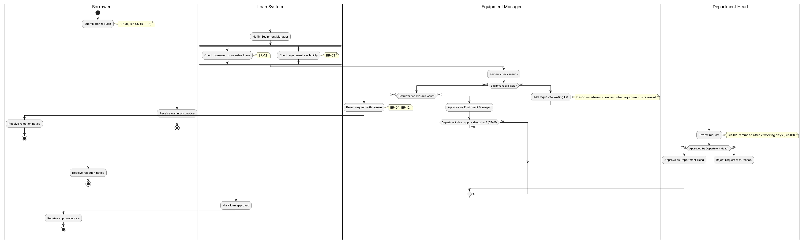

# 借用申请与审批的流程

## 这张图讲什么
一份借用申请从提交到批准、拒绝或进入等待名单，每一步由谁来做。

## 怎么读
- 四列分别是借用人、系统（Loan System）、设备管理员、部门负责人，步骤放在谁那一列，就由谁来做。
- 两条粗横线之间的两件事由系统同时检查：借用人有没有逾期未还的单子、设备够不够。两件都检查完才继续。
- 菱形是判断，按方括号里的结果走不同的路。
- 带圈的黑点是流程结束；带叉的圆圈表示这条路暂时到此为止（进入等待名单后，要等设备归还才会重新审核）。

## 用你的案例走一遍
GC-02：张老师提交申请 → 系统同时检查，张老师没有逾期、摄像机在库 → 管理员同意 → 因为是贵重设备，需要部门负责人审批（DT-01）→ 部门负责人同意 → 系统标记为已批准 → 张老师收到通知。
GC-03：S-014 的无线话筒逾期未还（台账 JY-0905）→ 管理员只能拒绝并填写原因 → S-014 收到拒绝通知。
GC-05：S-022 以前逾期过但已归还 → 检查结果显示没有逾期未还 → 管理员正常批准。

## 它决定了 app 的哪部分
审核页面同时显示两项检查结果；谁在什么时候能点"批准"或"拒绝"；什么情况下申请会转给部门负责人。

## 请你检查
1. 设备不够时，申请直接进入等待名单，管理员不需要再做决定。对吗？
2. 部门负责人只看管理员已经同意的申请。对吗？
3. 借用人撤回申请没有画在这张图里（批准前随时都可能发生），由状态图和用例图表示。这样可以接受吗？

## 我做的假设
- 无。
