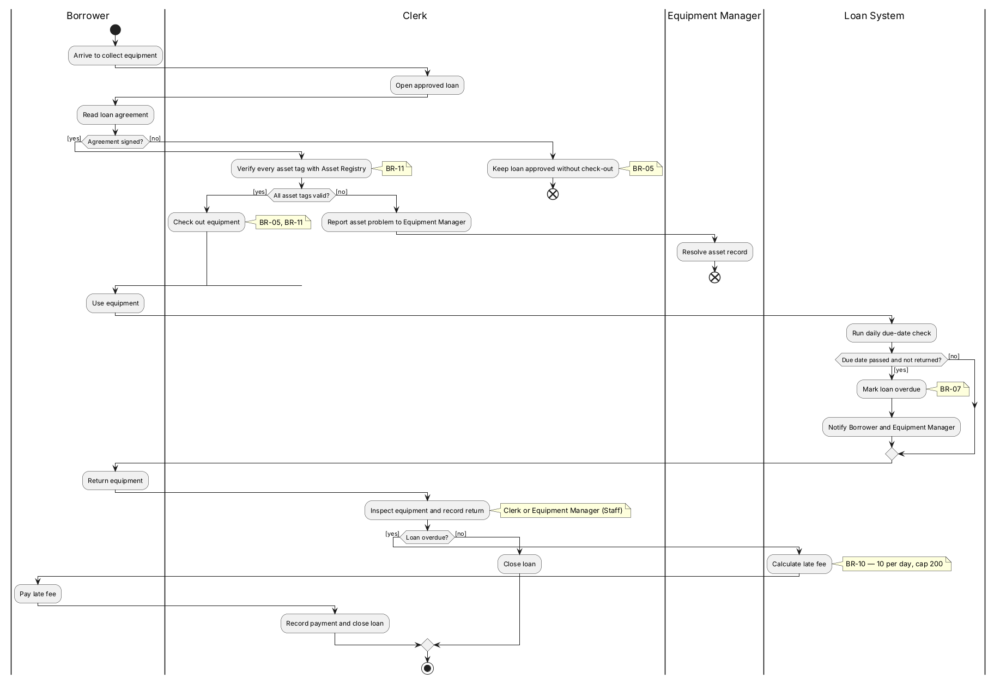

# 借出与归还的流程

## 这张图讲什么
批准后的借用单如何借出、如何发现逾期、如何归还和收取逾期费。

## 怎么读
- 四列分别是借用人、办事员、设备管理员、系统（Loan System）。
- 菱形是判断：协议签了没有、资产标签对不对、有没有过应还日期、归还时是否已逾期。
- 带叉的圆圈表示这次没借成，借用单保持已批准，等问题解决后再来。

## 用你的案例走一遍
GC-01：S-060 来领投影仪 → 办事员打开借用单 → S-060 签协议 → 办事员在资产系统核对标签通过 → 借出 → 11 月 10 日系统检查发现逾期，通知 S-060 和管理员 → 11 月 12 日归还 → 系统算出逾期 3 天、逾期费 30 元 → S-060 缴费 → 办事员关闭借用单。

## 它决定了 app 的哪部分
借出页面上的协议确认和标签核对、每日到期检查、归还时的逾期费计算。

## 请你检查
1. 资产标签有一件不对，整张单都不能借出。对吗？还是可以先借出其他没问题的设备？
2. 办理归还的可以是办事员，也可以是设备管理员（图中注明为 Staff）。对吗？
3. 逾期费由系统自动计算，办事员只登记已缴费，不能修改金额。对吗？

## 我做的假设
- 资产登记系统连不上时按"不能借出"处理（E22，已确认）。
