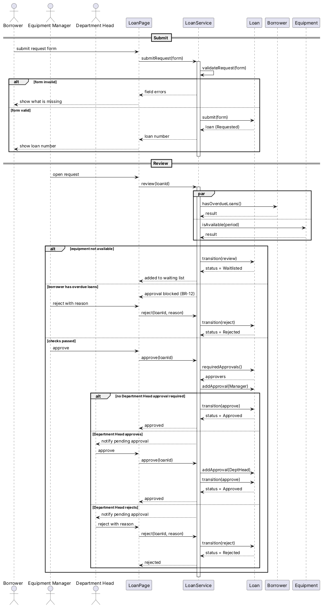

# 提交和审核时系统内部怎么配合

## 这张图讲什么
借用申请从提交到审核完成时，系统各部分按什么顺序配合。这张图偏技术，请重点看顺序和分支是否符合业务。

## 怎么读
- 顶部从左到右：三类使用者、页面（LoanPage）、后台处理（LoanService）、借用单、借用人记录、设备。LoanPage 和 LoanService 是系统内部的组成部分，不是业务上的东西。
- 时间从上往下走。实线箭头是请对方做事，虚线是回复，指向自己的箭头是内部检查。
- par 框里的两项检查同时进行；alt 框按条件分成几种情况，每次只走其中一格。

## 用你的案例走一遍
GC-02：张老师提交 → 后台检查必填项和借期（validateRequest）→ 创建借用单 → 管理员打开审核 → 后台同时查张老师有没有逾期、摄像机够不够 → 两项都通过，管理员批准 → 后台查出还需要部门负责人审批 → 走"部门负责人同意"那一格 → 借用单变为已批准。

## 它决定了 app 的哪部分
后台处理申请和审批的先后顺序，以及每种情况下页面上显示什么。

## 请你检查
1. 部门负责人拒绝时，借用单直接变为已拒绝，不再回到管理员。对吗？
2. 批准的那一刻系统会再查一次库存（防止两人同时批准抢同一台设备）。可以接受吗？

## 我做的假设
- LoanPage、LoanService 是界面和服务对象，不在业务类图中。
- 表单数据结构（LoanForm）和日期区间（DateRange）在实现时定义。
