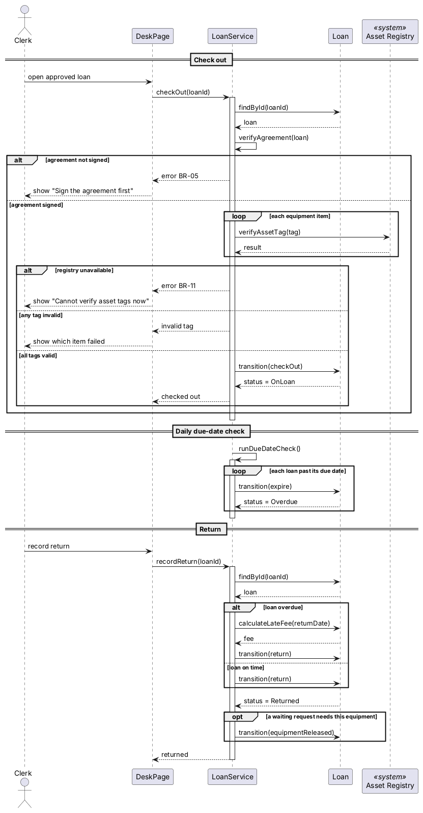

# 借出、到期检查和归还时系统内部怎么配合

## 这张图讲什么
借出、每日到期检查和归还三件事在系统内部的处理顺序。

## 怎么读
- 顶部从左到右：办事员、柜台页面（DeskPage）、后台处理（LoanService）、借用单、资产登记系统。
- loop 框表示重复做：借出时每件设备都要核对一次标签；到期检查时每张过期的借用单都要处理一次。
- alt 框按条件分格；opt 框只在条件满足时才做。

## 用你的案例走一遍
GC-01：办事员办理借出 → 后台确认协议已签 → 逐件向资产登记系统核对标签 → 全部通过 → 借用单变为借出中 → 到期次日，后台的到期检查把它变为已逾期 → 归还时，后台算出逾期费 30 元 → 借用单变为已归还。
GC-04：无人机归还时，后台发现有等待这台无人机的借用单（opt 框），把那张单送回审核。

## 它决定了 app 的哪部分
借出时的检查顺序和错误提示、到期检查的处理方式、归还时逾期费的计算时机。

## 请你检查
1. 资产系统连不上时提示"暂时无法核对资产标签"，借用单保持已批准。这个提示语可以吗？
2. 归还一件设备时，如果有多张等待中的借用单都需要它，先通知提交最早的那张。对吗？

## 我做的假设
- 到期检查在原型中由设备管理员手动触发演示，正式系统改为每日定时运行（见构建计划）。
