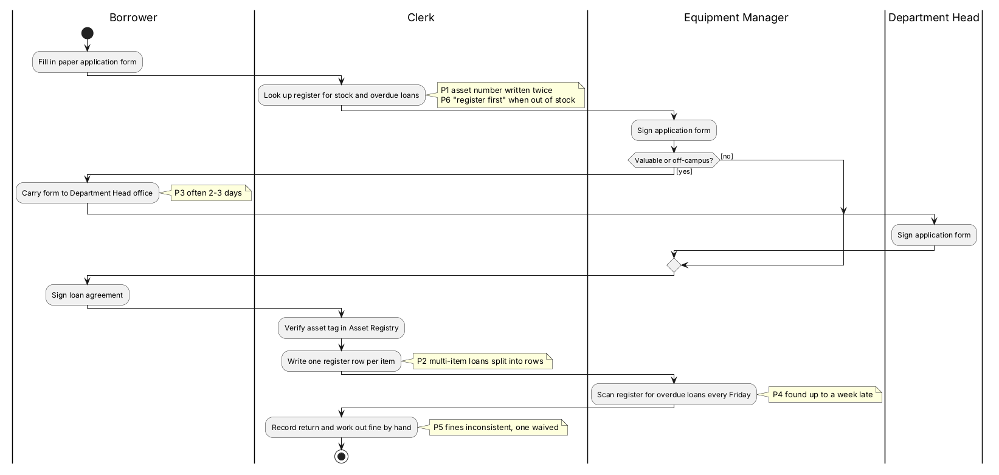

# 现在是怎么做的

## 这张图讲什么
上系统之前，设备借用现在的做法，以及每个环节的痛点（黄色便签 P1–P7）。

## 怎么读
- 四列分别是借用人、办事员、设备管理员、部门负责人。
- 黄色便签是这一步的痛点，编号对应 `01-as-is.md` 中的痛点表。

## 用你的案例走一遍
GC-02 在现状下：张老师填纸质申请单 → 办事员翻台账查库存和逾期 → 管理员签字 → 因为是贵重设备，张老师自己拿单子去办公室找部门负责人签字（P3，常常拖 2–3 天）→ 回设备室签协议 → 办事员核对标签、在台账登记一行 → 归还后办事员手工登记。

## 它决定了 app 的哪部分
不直接决定 app 的结构。它用来对照：目标流程要说明解决了哪些痛点，同时保留现状中合理的环节（先管理员后部门负责人、借出前签协议和核对标签）。

## 请你检查
1. 现状流程有没有漏掉的步骤？
2. 痛点 P1–P7 有没有说得不准确的？

## 我做的假设
- 无。
