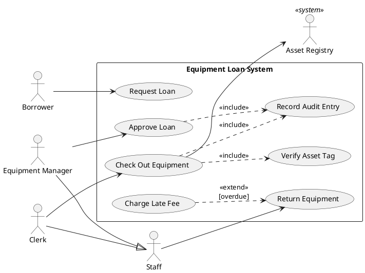
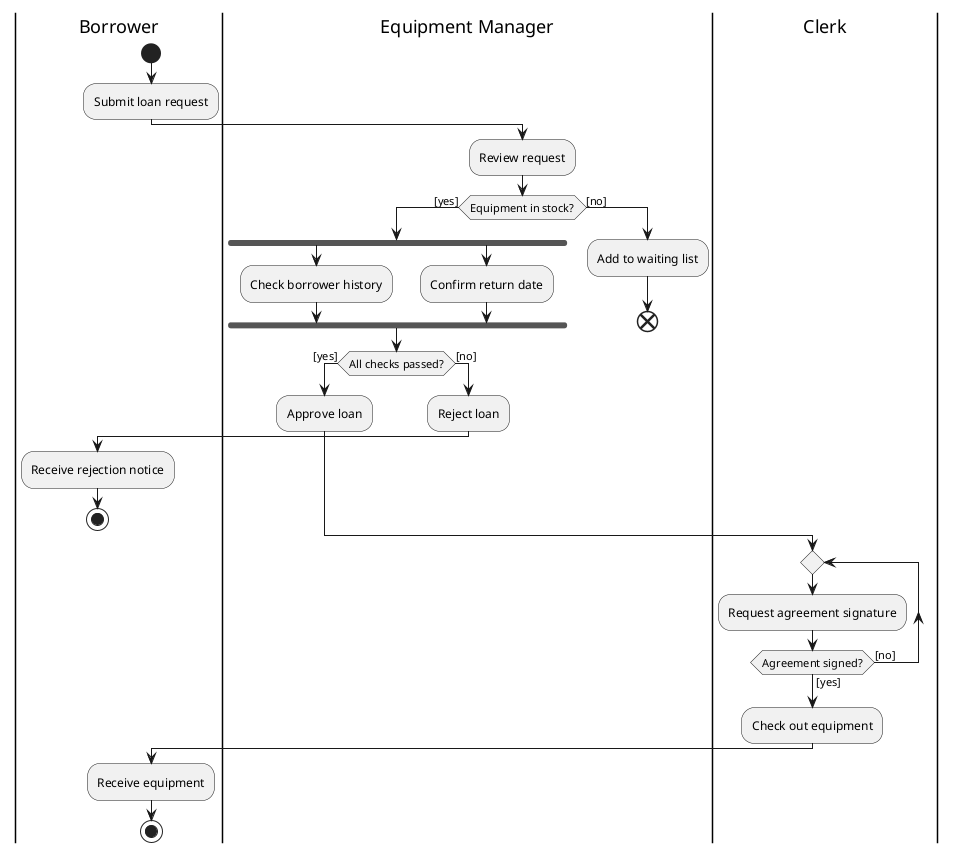
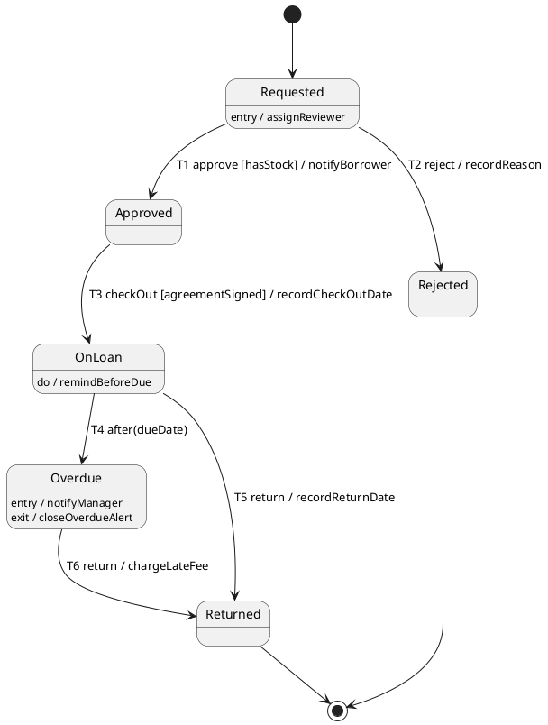
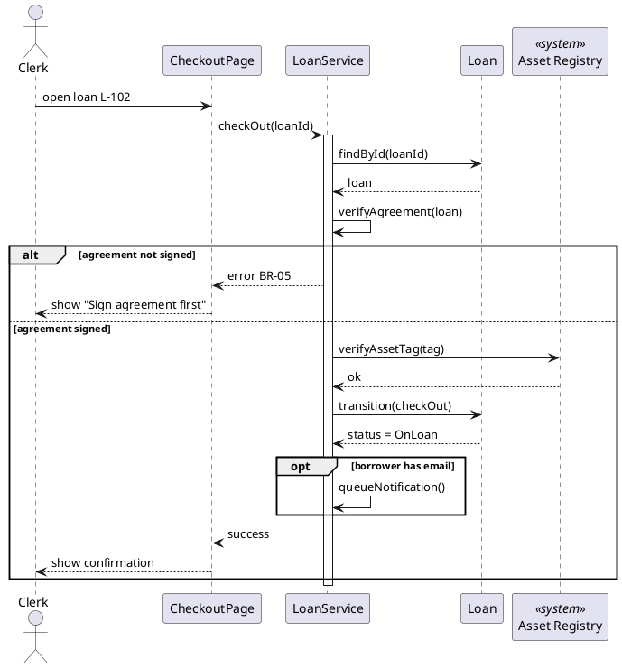
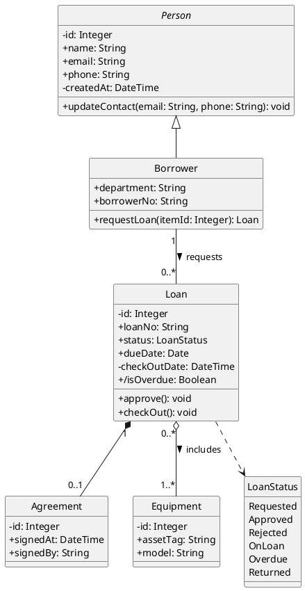

# PlantUML 写法与常见错误

阶段 3 写任何一张图之前先读本文件。每种图给出一段**能直接渲染的标准写法**，再列出语法错误（图画不出来）和语义错误（图画出来了但意思不对）。语义错误更危险，因为它会被原样映射成代码（见 `uml-to-code-mapping.md`）。

## 目录

1. 通用规则
2. 用例图
3. 活动图
4. 状态机图
5. 序列图
6. 类图
7. 渲染与排错

---

## 1. 通用规则

- 每张图一个 `.puml` 文件，以 `@startuml <文件名>` 开头、`@enduml` 结尾。文件名格式：`<序号>-<图类型>-<主题>.puml`，例如 `03-state-loan.puml`。`@startuml` 后的名字必须与文件名（去掉 `.puml`）完全相同，因为渲染出的图片按这个名字命名，说明卡靠它引用图片。
- 图类型只能是 `usecase`、`activity`、`state`、`sequence`、`class` 之一；状态机文件的主题必须是它描述的类名（如 `03-state-loan.puml` 对应类 `Loan`），检查脚本靠文件名识别图的类型和对应的类。
- 所有元素名取自术语表的英文名。名字含空格时用引号加别名：`actor "Equipment Manager" as Manager`，之后一律用别名引用。
- 图上可以写中文标签，但标识符（别名、类名、状态名）用英文，与代码保持一致。
- 每张图第一行注释写明它对应的流程或实体，以及依据的 BR 编号范围：`' Loan lifecycle — BR-01..BR-09`。
- 不要为了好看使用非标准形状或颜色表达含义。颜色只用于区分，不能承载业务含义。

---

## 2. 用例图

### 标准写法

### 语法错误

- include / extend 用实线 `-->`：应该用虚线 `..>` 并加 `<<include>>` / `<<extend>>` 标签。
- 别名与显示名混用：定义了 `as UC1` 之后又写 `"Request Loan" --> ...`，会生成一个新的重复用例。

### 语义错误

- **extend 方向反了**：extend 的箭头从**扩展用例**指向**基础用例**（`UC6 ..> UC4`）；include 的箭头从**基础用例**指向**被包含用例**（`UC3 ..> UC5`）。
- **用例之间画了普通连线或流程箭头**：用例图不表达先后顺序，顺序属于活动图。
- **用例太细或太粗**："点击提交按钮"太细，"管理系统"太粗。用例应是参与者想完成的一件完整的事，用"动词 + 名词"命名。
- **参与者画在系统边界内**：参与者必须在 `rectangle` 外面。
- **父角色没有连接任何用例**：泛化的意义在于子角色继承父角色能做的事。父角色（如 `Staff`）应连接所有子角色共有的用例（如"Return Equipment"），否则泛化是多余的。
- **外部系统画成人形且没有标记**：加 `<<system>>` 标记，以便映射成适配器而不是角色。
- **extend 没写条件**：在标签上写出扩展条件（如 `[overdue]`），条件必须对应一条 BR。
- **与角色视角表、CRUD 矩阵不一致**：用例图里角色能做的事，必须与另外两张表完全对得上。

---

## 3. 活动图

使用 PlantUML 的新版活动图语法（以 `start` 开头、动作写成 `:动作;`）。

### 标准写法

### 语法错误

- 动作忘了结尾分号：`:Approve loan` 应为 `:Approve loan;`。
- `if` 缺少 `endif`，`fork` 缺少 `end fork`，`repeat` 缺少 `repeat while`。
- 混用旧版语法（`(*) --> "动作"`）和新版语法：一张图只用新版语法。
- 泳道名写法不一致：`|Clerk|` 和 `|clerk|` 会被当作两条泳道。
- **分支里切换泳道后忘了切回来**：在 `if` 的一个分支里写了 `|Borrower|`，后面的 `else` 分支和后续动作会继续留在 Borrower 泳道。每个分支的第一个动作前，如果泳道和上一个动作不同，都要显式写出泳道名。渲染后逐个核对每个动作所在的泳道。

### 语义错误

- **fork/join 卡死**：fork 之后的某个分支在 `end fork` 之前结束流程（例如一项检查不通过就拒绝），join 会永远等不到它。正确做法：并行分支都只做检查并记录结果，在 `end fork` **之后**再用一个决策点判断结果（如上例的 `All checks passed?`）。
- **并行其实有依赖**：如果分支 B 要用到分支 A 的结果，它们就不是并行的，应该画成先后顺序。
- **决策条件不互斥或不完整**：每个决策点的出边条件必须互斥并覆盖所有情况；用 `[yes]` / `[no]` 或 `[else]` 兜底。
- **决策写成动作**：`:Check if in stock;` 后面直接接下一步，等于没有分支。凡是有不同结果的判断，都要用 `if`。
- **泳道与执行者不符**：动作放在哪条泳道，就表示哪个角色执行，会被映射成权限。系统自动做的事放在系统泳道。
- **`stop` 和 `end` 混用**：`stop` 是整个活动结束；`end` 在上例中表示这条路径终止（在这个流程内不再继续）。区别要和业务含义一致，并与状态机的终止状态对应。
- **改变状态的动作在状态机里找不到对应转换**：例如活动图有"Reject loan"，状态机里就必须有到 `Rejected` 的转换。

---

## 4. 状态机图

### 标准写法

### 语法错误

- 转换标签格式写乱：标准顺序是 `触发 [守卫] / 效果`，守卫必须放在方括号里，效果放在斜杠后面。
- 内部动作写在转换上：`entry` / `exit` / `do` 写成 `状态名 : entry / 动作`，不写在箭头上。
- 状态名含空格却没加引号：用 `state "On Loan" as OnLoan`，之后引用别名。

### 语义错误

- **有到达不了的状态**：从 `[*]` 出发，每个状态都必须能到达。
- **有出不去的非终止状态**：除了指向 `[*]` 的终止状态，每个状态都至少要有一条出去的转换，否则实体会卡住。
- **转换没有触发**：每条转换都要写清楚由什么引起：用户操作（`approve`）、时间（`after(dueDate)`）或条件（`when(...)`）。
- **同一状态、同一触发有多条出边，但守卫不互斥**：系统不知道该走哪条。
- **守卫与活动图的决策条件说法不同**：例如活动图写 `Equipment in stock?`，状态机写 `[available]`。两者要用同一个术语表名字，并对应同一条 BR。
- **把动作当成状态**：`Approving` 只有在审批是一段需要等待的时间时才是状态；如果审批是瞬间完成的操作，它是转换，不是状态。
- **转换没有编号**：标签以 `T1`、`T2`…… 开头，代码里的转换表用同样的编号（见 `uml-to-code-mapping.md` 第 8 节）。
- **转换效果和目标状态的 entry 动作重复**：例如 `Requested --> Waitlisted : T1 review / notifyBorrower`，同时又写了 `Waitlisted : entry / notifyBorrower`，照图实现借用人会收到两条通知。进入某状态就一定要做的事写在 entry 里，转换上不再重复（检查项 A13，脚本会阻断）。
- **动作没有出处**：`do / remindBeforeDue` 这类动作很容易顺手画上去，但没人说过"什么时候提醒、提醒谁"。每个效果和 entry / do / exit 动作的上一行用注释写明依据（`' BR-07`、`' FUS8 AC1`、`' [用户]`），写不出的回到规格向用户确认（检查项 H8）。
- **漏画效果**：规则里说"有设备归还后通知等待的人"，归还转换上就需要"释放设备"这类效果；AC 说"取消后借用人收到通知"，取消转换上就要有通知。画完后对照每条 BR 和 AC 中"通知谁、释放什么、记录什么"逐条找（检查项 H9）。

---

## 5. 序列图

### 标准写法

### 语法错误

- `alt` / `opt` / `loop` 忘记写 `end`。
- `alt` 的第二个分支写成新的 `alt`，应该用 `else`。
- 返回消息用了实线：同步调用用 `->`，返回用虚线 `-->`。

### 语义错误

- **生命线不是类图里的类**：领域对象的生命线名必须是类图中的类名；界面和服务对象可以额外添加，但要在说明卡里写明。
- **消息不是该类的操作**：发给领域对象生命线的消息，应能在类图中该类的操作里找到。
- **alt 分支与活动图的决策点对不上**：每个 `alt` 的条件应对应活动图中一个决策点的守卫。
- **跳过了状态变更**：改变状态的步骤必须体现为对实体的 `transition(...)` 调用，与状态机的转换编号一致，不能写成直接赋值。
- **没有自调用但存在内部校验**：重要的内部校验（如协议是否签署）应画成自调用消息，它会映射成服务层的校验函数。
- **外部系统没有失败分支**：调用外部系统时，至少在说明卡里注明不可用时的处理，最好在图里用 `alt` 画出。

---

## 6. 类图

### 标准写法

### 语法错误

- 属性写成 `name String` 或 `String name`：统一用 `可见性 名称: 类型`，例如 `+name: String`。
- 操作缺少括号：`+approve: void` 会被当成属性，应为 `+approve(): void`。
- 多重性没有加引号：`Loan 1 *-- 0..1 Agreement` 无法解析，应为 `Loan "1" *-- "0..1" Agreement`。
- 想用可见性符号却显示成图标：加 `skinparam classAttributeIconSize 0`，图上就显示 `+ - # ~` 字符，便于检查。

### 语义错误

- **组合、聚合的菱形画反**：`A *-- B` 的菱形在 **A** 一端，表示 A 是整体。写成 `Agreement *-- Loan` 就变成了"协议包含借用单"，级联删除方向会反。
- **该用组合却用了聚合（或相反）**：问一句"整体删除后，部分还有意义吗？" 没有意义用组合，有意义用聚合，两者都不是就用普通关联。
- **泛化箭头方向反了**：`Person <|-- Borrower` 表示 Borrower 是一种 Person，三角形在父类一端。
- **缺少多重性**：每条关联两端都要写多重性，它直接决定外键是否可空和是否需要关联表。
- **状态用 String 而不是枚举**：有状态机的实体，其 `status` 字段的类型必须是枚举，枚举值与状态机的状态完全一致。
- **类名、属性名与术语表不一致**：例如术语表叫 `Borrower`，类图写成 `Applicant`。
- **操作和序列图对不上**：序列图里发给该类的消息，在类图里找不到对应的操作。
- **把界面或服务对象画进领域类图**：`LoanService`、`CheckoutPage` 属于实现层，不放进类图（除非用户要求画设计类图）。

---

## 7. 渲染与排错

- 用 `scripts/render_uml.sh spec/models` 在本地渲染成 PNG 和 SVG。默认使用本地的 PlantUML，不把图的内容发送到外部服务。
- 本地没有 Graphviz 时，在 `@startuml` 下一行加 `!pragma layout smetana`，用 PlantUML 内置的布局引擎渲染用例图、类图和状态机图。活动图和序列图不依赖 Graphviz。
- 渲染出的图片中出现 "Syntax Error" 字样时，错误信息会给出行号，回到对应行检查本文件列出的语法错误。
- 图上的中文标签显示成方块时，说明系统缺少中文字体，可以在图里设置 `skinparam defaultFontName`，或改用英文标签。
- 图太宽看不清时：用例图加 `left to right direction`；活动图减少泳道数量；类图把枚举和次要类拆到第二张图。
- 渲染成功不代表图是对的。渲染后还要按 `consistency-checklist.md` 做一致性检查。
